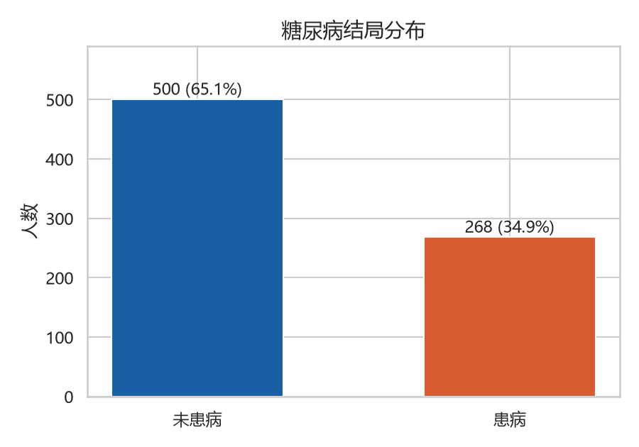
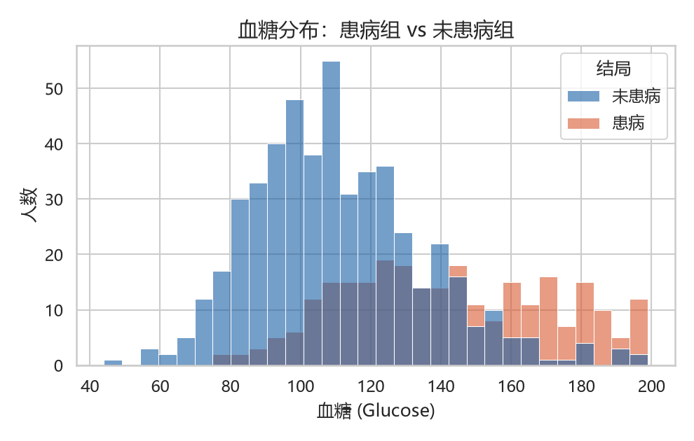
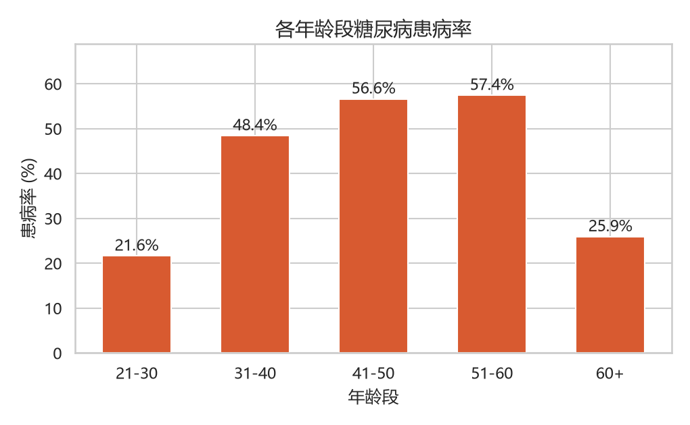
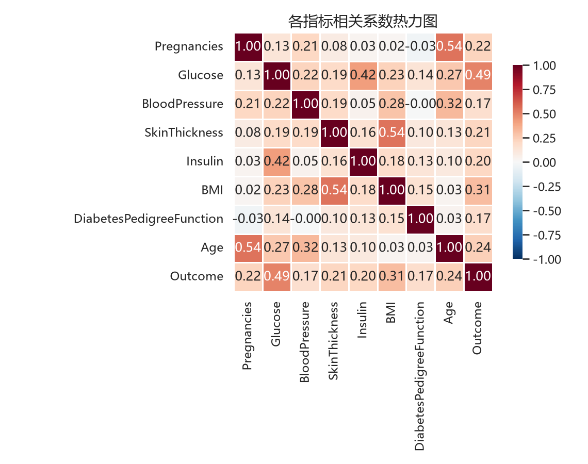

# medical-data-101

基于 Pima Indians Diabetes 数据集的一次完整医学数据分析实践，覆盖**数据探查 → 缺失值识别 → 清洗 → 统计可视化 → 结论输出**全流程。

本项目的核心关注点不是建模，而是**医疗数据中「以 0 编码缺失值」这一问题的识别与处理**——这类缺失无法被 `isnull()` 直接检出，是临床数据清洗中的常见情形。

---

## 数据集

**Pima Indians Diabetes Database**

| 项目 | 说明 |
| --- | --- |
| 来源 | UCI Machine Learning Repository / Kaggle |
| 样本 | 768 名 21 岁以上皮马印第安女性 |
| 任务 | 依据体检指标判断是否患糖尿病（二分类） |
| 字段数 | 9（8 个特征 + 1 个结局变量） |

<details>
<summary>字段说明</summary>

| 字段 | 含义 | 单位 |
| --- | --- | --- |
| Pregnancies | 怀孕次数 | 次 |
| Glucose | 口服葡萄糖耐量试验 2 小时血糖 | mg/dL |
| BloodPressure | 舒张压 | mm Hg |
| SkinThickness | 三头肌皮褶厚度 | mm |
| Insulin | 2 小时血清胰岛素 | mu U/ml |
| BMI | 体重指数 | kg/m² |
| DiabetesPedigreeFunction | 糖尿病家系函数（遗传倾向评分） | — |
| Age | 年龄 | 岁 |
| Outcome | 是否患病（0 = 否，1 = 是） | — |

</details>

---

## 数据质量处理

初始调用 `isnull().sum()` 显示**零缺失**，但进一步统计发现以下 5 列存在大量 `0` 值。这些指标在活体测量中不可能为 0，因此判定为**以 0 编码的缺失值**：

| 字段 | 0 值个数 | 占比 |
| --- | --- | --- |
| Insulin | 374 | 48.7% |
| SkinThickness | 227 | 29.6% |
| BloodPressure | 35 | 4.6% |
| BMI | 11 | 1.4% |
| Glucose | 5 | 0.7% |

**处理方式**：统一替换为 `NaN`，再按各列中位数填补。

选择中位数而非均值，是因为医疗数据中常存在极端离群值（如 Insulin 可达 800+），均值会被显著拉偏。

---

## 分析结果

| 结局分布 | 血糖分布：患病 vs 未患病 |
| :---: | :---: |
|  |  |

| 各年龄段患病率 | 相关系数热力图 |
| :---: | :---: |
|  |  |

---

## 主要结论

1. **总体患病率 34.9%**（268 / 768）。

2. **血糖是最强的单指标判别因子**：患病组均值 142.1 mg/dL，未患病组 110.7 mg/dL，两组分布明显分离，相关系数 r = +0.493，为全部指标中最高。

3. **患病率随年龄上升**，51–60 岁组达最高 57.4%。需注意 60 岁以上组回落至 25.9%，但该组样本仅 27 人，且可能存在幸存者效应，不宜据此推断高龄风险下降。

4. **相关性前三**：Glucose（+0.493）、BMI（+0.312）、Age（+0.238）。

---

## 局限说明

- **样本代表性**：全部为单一族群女性，结论不可外推至其他人群。
- **Insulin 缺失近半**：中位数填补会人为压缩该变量的方差，涉及胰岛素的统计推断需谨慎。
- **方法学**：本项目为描述性分析，相关系数仅反映线性关联，不构成因果结论。

---

## 如何运行

```bash
pip install -r requirements.txt

python step1_load.py     # 数据探查
python step2_clean.py    # 缺失值处理
python step3_charts.py   # 生成图表到 output/
```

环境：Python 3.9+，依赖 pandas / matplotlib / seaborn。

---

## 项目结构

```
medical-data-101/
├── step1_load.py        # 数据探查：规模、类型、分布、缺失检查
├── step2_clean.py       # 0 值识别与中位数填补，生成清洗后数据
├── step3_charts.py      # 四张统计图输出
├── data/                # 原始与清洗后数据
└── output/              # 生成的图表
```
